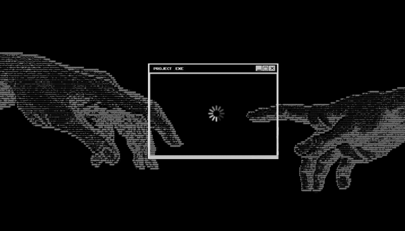

<!-- ================= HEADER ================= -->

  

  
  

    

  

---

## About me

I'm a French Computer Science student and Full Stack Developer interested in building useful applications, developer tools and scalable software.

- Currently working on **[Pokédex](https://github.com/Samuel-BONNET/pokedex)**
- Interested in software architecture, automation and application development.
- Focused on building reliable and maintainable solutions.
- Portfolio: **[portfolio.bsoul.site](https://portfolio.bsoul.site)**

## Selected Projects

<table>
  <tr>
    <td width="50%">
      <h3>Pokédex</h3>
      
      
Pokémon collection manager. Organize captures, game saves and global preferences.

      
<code>Nuxt</code> <code>Vue</code> <code>PostgreSQL</code> <code>Prisma</code>

    </td>
    <td width="50%">
      <h3>Texas Hold'Soul</h3>
      
      
Online multiplayer Texas Hold'em poker with real-time communication.

      
<code>Rust</code> <code>Axum</code> <code>Leptos</code> <code>WebSockets</code>

    </td>
  </tr>

</table>

---

## Tech Stack & Skills

### Languages

  

### Frontend Development

  

### Backend Development

  

### Databases & Data Management

  

### DevOps, CI/CD & Infrastructure

  

### Testing & Quality

  

### Concepts & Practices

  
  
  
  
  
  
  
  

